# 🚀 ASP.NET Core 6.0 MVC Dynamic Portfolio & Admin Dashboard

Bu proje; kişisel portfolyo verilerinin, projelerin, yeteneklerin, eğitimlerin ve gelen mesajların dinamik olarak yönetilebildiği modern bir **Kişisel Portfolyo ve Yönetim Paneli (Admin Dashboard)** web uygulamasıdır.

Proje, katmanlı mimari prensiplerine uygun olarak **ASP.NET Core 6.0 MVC** ve **Entity Framework Core** ile geliştirilmiştir.

---

## 📸 Proje Ekran Görüntüleri

### 🖥️ Kullanıcı Arayüzü (Ön Yüz / Visitor View)

| Ana Sayfa | Hakkımda |
| :---: | :---: |
| 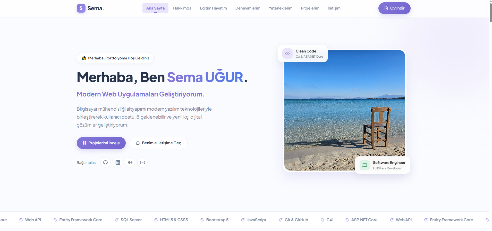 | 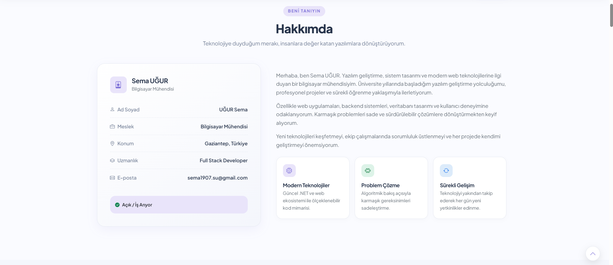 |

| Projeler | Yetenekler |
| :---: | :---: |
| 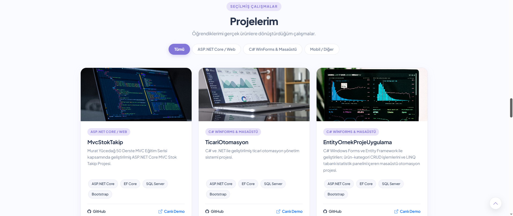 | 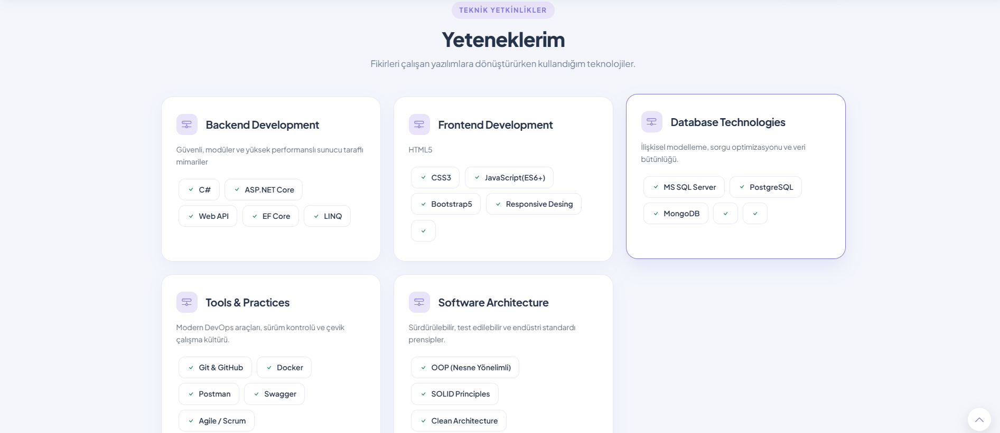 |

| Eğitim | Deneyim |
| :---: | :---: |
| 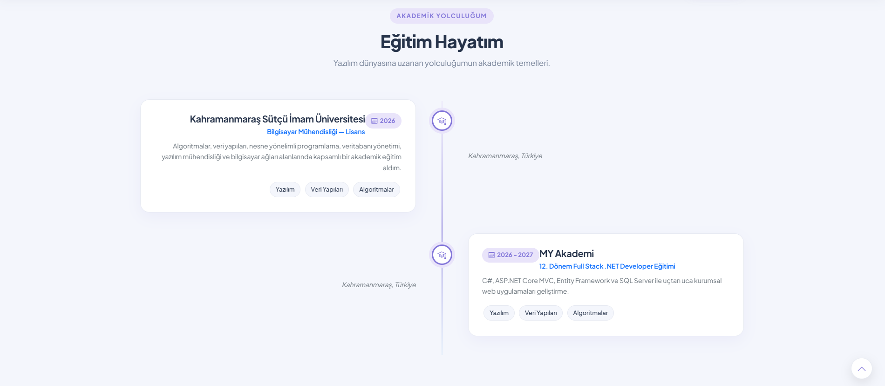 | 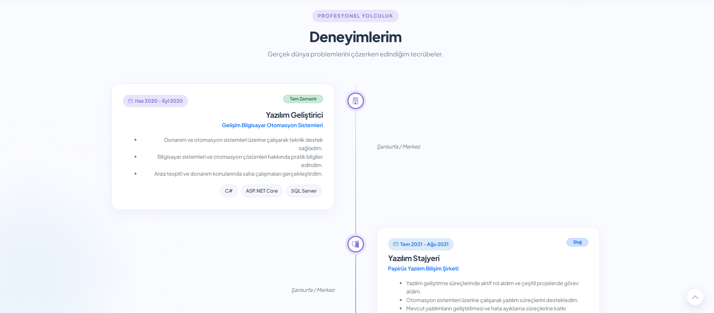 |

| Sertifikalar | İletişim |
| :---: | :---: |
| 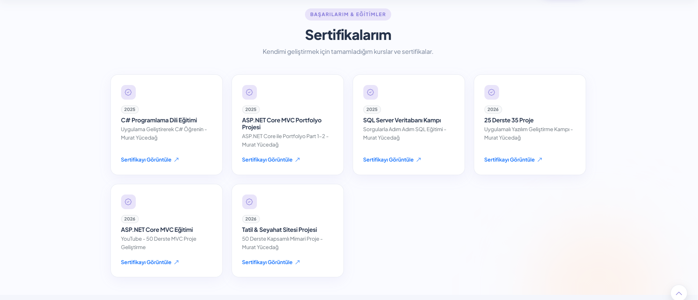 | 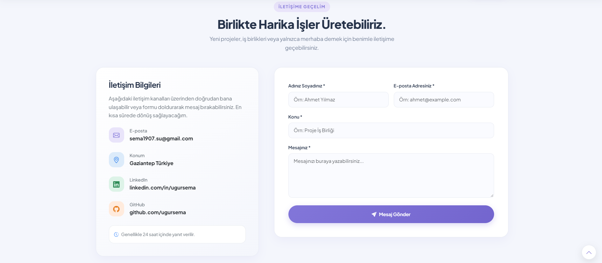 |

---

### ⚙️ Yönetim Paneli (Admin Dashboard & Management)

| Admin Dashboard | Proje Yönetimi |
| :---: | :---: |
| 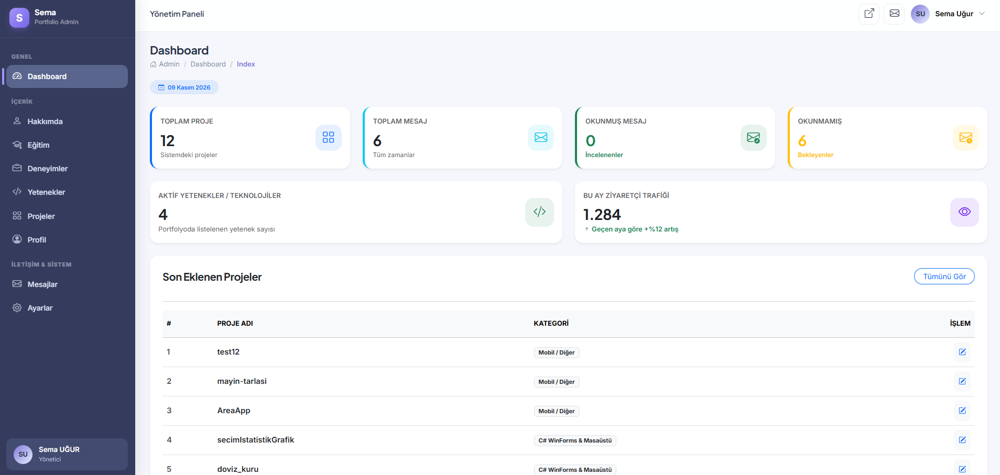 | 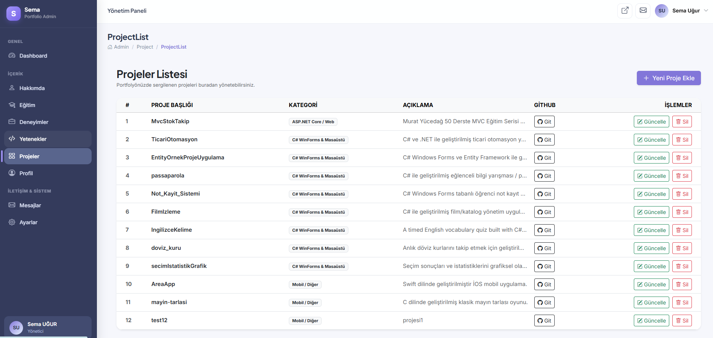 |

| Hakkımda Yönetimi | Yetenek Yönetimi |
| :---: | :---: |
| 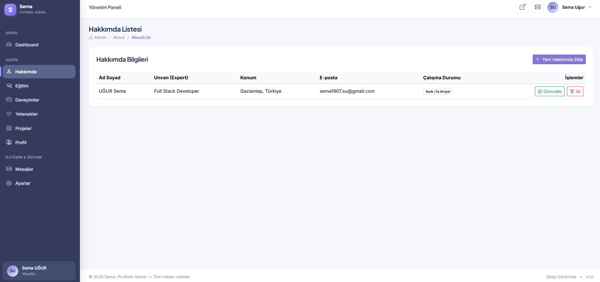 | 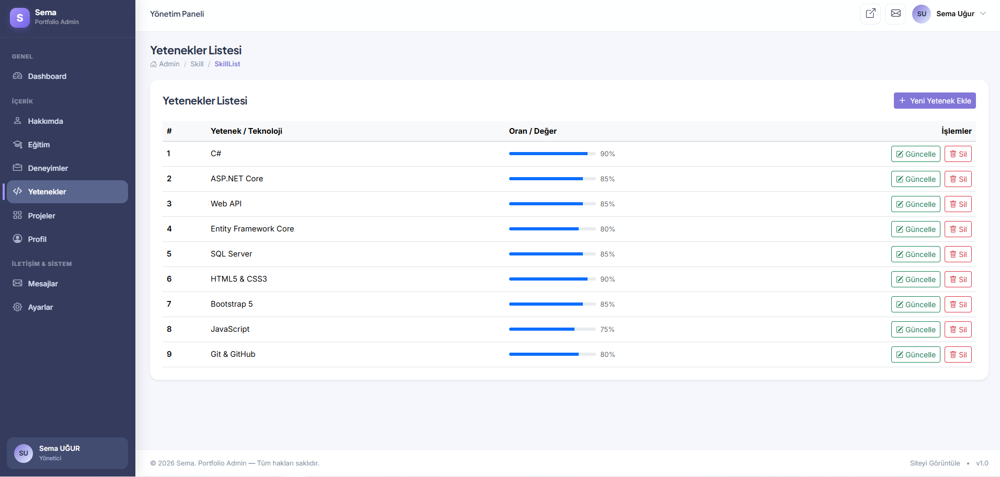 |

| Eğitim Yönetimi | Deneyim Yönetimi |
| :---: | :---: |
| 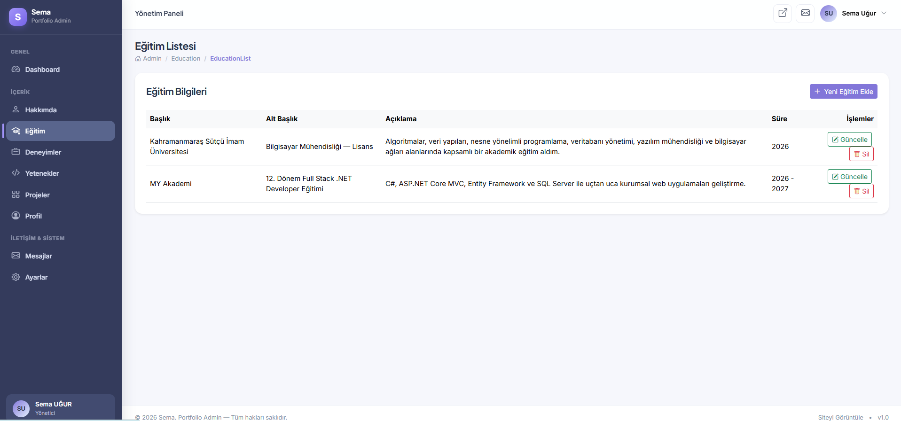 | 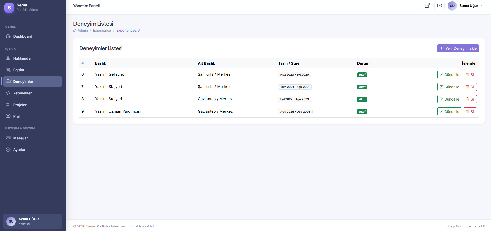 |

| Mesajlar | Profil |
| :---: | :---: |
| 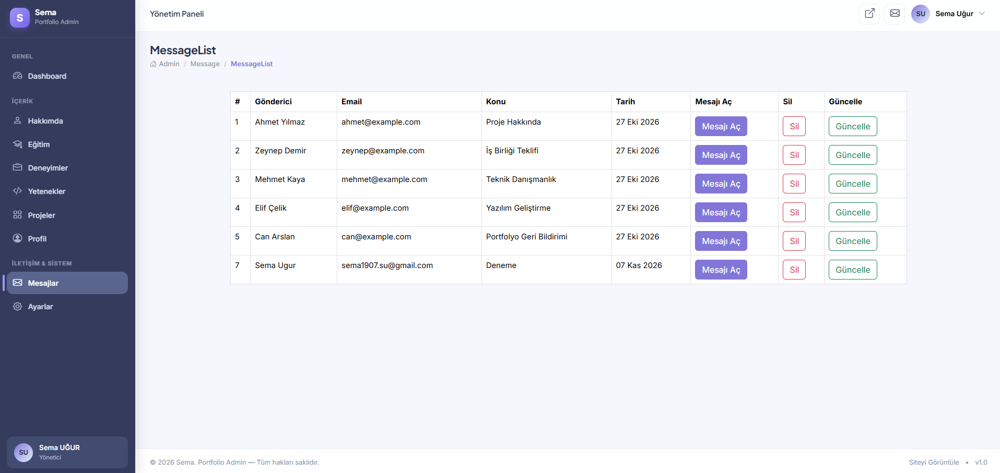 | 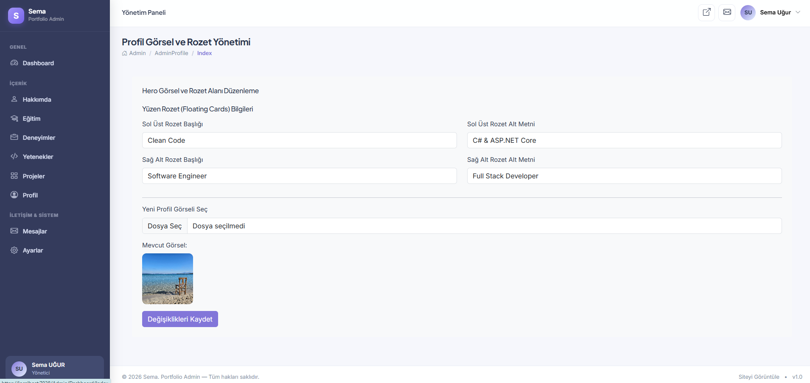 |

| Ayarlar |
| :---: |
| 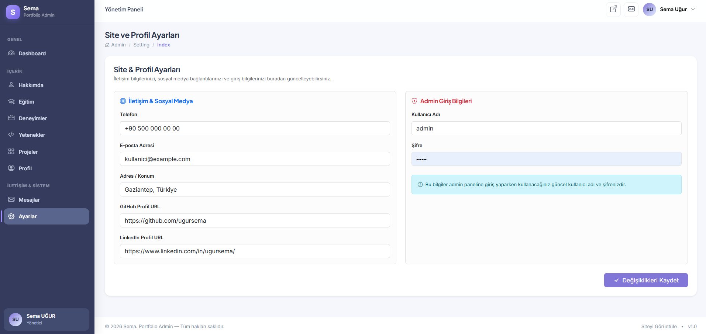 |

---

## 🛠️ Öne Çıkan Özellikler ve Arayüz Bileşenleri

- **Dinamik İstatistik Kartları:** Toplam proje, toplam mesaj, okunmuş/okunmamış mesaj ve aktif yetenek sayıları veritabanından anlık çekilir ve tıklanabilir yönlendirme kartları şeklinde sunulur.
- **Son Eklenen Projeler Tablosu:** Dashboard üzerinde en son eklenen 5 proje LINQ sorgusuyla (`OrderByDescending` & `Take(5)`) kategorileriyle birlikte dinamik olarak listelenir.
- **Yetenek & Teknoloji Seviyeleri:** Sağ panelde yetenek yetkinlik oranları Bootstrap `progress-bar` bileşenleri ile görselleştirilmiştir.
- **Modüler Yapı (ViewComponent):** Dashboard üzerindeki bileşenler, istatistik alanları ve dinamik bölümler `ViewComponent` mimarisiyle modüler ve tekrar kullanılabilir şekilde tasarlanmıştır.
- **Kapsamlı Yönetim Modülleri:** Hakkımda, Eğitimler, Deneyimler, Yetenekler, Projeler, Mesajlar ve Profil ayarları Admin paneli üzerinden kolayca güncellenebilir.

---

## 💻 Kullanılan Teknolojiler

- **Backend:** ASP.NET Core 6.0 MVC
- **ORM & Database:** Entity Framework Core (Code-First / DB-First), Microsoft SQL Server (MSSQL)
- **Güvenlik & Yetkilendirme:** ASP.NET Core Authentication & Cookie tabanlı Authorize yetkilendirmesi (`[Authorize]`, `[Area("Admin")]`)
- **Frontend:** Bootstrap 5, HTML5, CSS3, JavaScript, Bootstrap Icons
- **Mimari Yapılar:** Area Mimarisi, LINQ Sorguları, ViewComponent, DTO & Model Yönetimi, ViewBag Veri Taşıma

---

## 📂 Proje Klasör Yapısı

```text
MyPortfolioProject/
│
├── MyPortfolioProject/
│   ├── Areas/
│   │   └── Admin/
│   │       ├── Controllers/
│   │       └── Views/
│   │
│   ├── Controllers/
│   ├── Entities / Models/
│   ├── Context/
│   ├── ViewComponents/
│   ├── wwwroot/
│   │   └── images/
│   │
│   └── Program.cs
│
└── README.md
```
